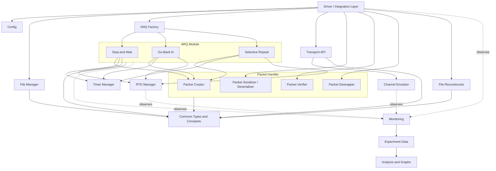
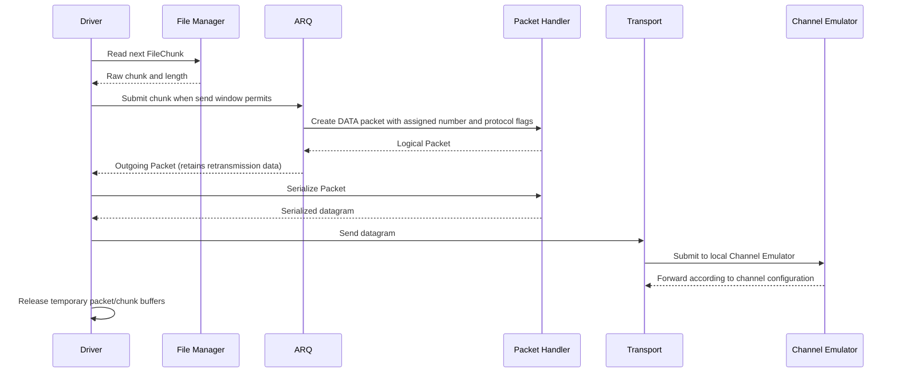
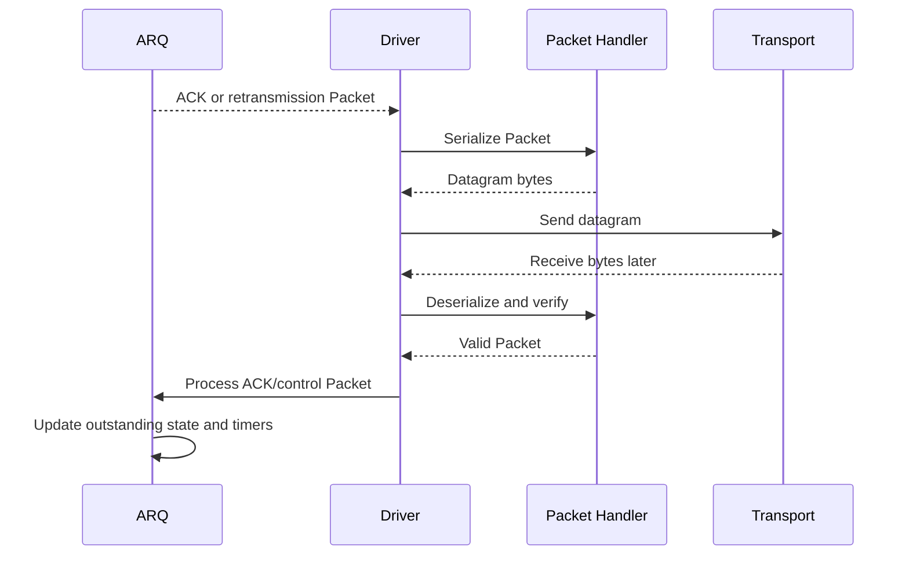

# System Architecture — Reliable Data Transfer over UDP

## 1. Overview

This project implements reliable file transfer over UDP using interchangeable Automatic Repeat reQuest (ARQ) protocols:

- Stop-and-Wait
- Go-Back-N
- Selective Repeat

The architecture separates file access, ARQ reliability, packet representation and wire-format handling, transport, channel emulation, timeout estimation, file reconstruction, and monitoring. The Driver is the integration layer: it coordinates the lifecycle and moves data between module interfaces, but it does not implement reliability algorithms itself.

The sender and receiver are roles for a particular transfer rather than permanent machine identities. For a transfer, the machine sending the file runs the Channel Emulator locally through its sender Transport configuration. The receiver uses its receiver Transport configuration to communicate with the sender endpoint.

## 2. Architecture and Dependencies



### Dependency rules

1. **Driver coordinates modules.** It initializes and closes components, requests file chunks, drives the send/receive loop, and routes packets and delivered data between public interfaces.
2. **ARQ depends on Packet Creator, Timer, RTO, and shared types.** ARQ determines protocol information and reliability behavior, but it does not perform UDP I/O, serialize datagrams, or open files.
3. **Packet does not depend on ARQ.** It owns packet construction, serialization, deserialization, checksum verification, and payload extraction.
4. **Transport handles bytes only.** It does not inspect packet flags, sequence numbers, payload formats, checksums, or retransmission state.
5. **Channel Emulator models an unreliable network path.** It may affect data and control datagrams, but it does not implement ARQ logic.
6. **Timer and RTO provide mechanisms and estimates.** They do not decide which packets should be retransmitted; ARQ makes that decision.
7. **File Manager and File Reconstructor do not implement reliability.** They handle file data and integrity information, while ARQ provides ordered delivery.
8. **Monitoring is observational.** It must not influence protocol decisions.

## 3. Module Responsibilities

### 3.1 Driver / Integration Layer

The Driver owns the transfer lifecycle and coordinates otherwise independent module APIs.

Responsibilities:

- Read configuration and select the ARQ protocol.
- Initialize the File Manager, ARQ context, Transport, and reconstruction resources as applicable to the local role.
- Obtain `FileChunk`s from the File Manager and submit them to ARQ.
- Pass ARQ-produced logical packets to the Packet Serializer, then submit serialized datagrams to Transport.
- Receive datagrams from Transport and pass them to the Packet Handler for deserialization and verification.
- Pass verified packets to ARQ for protocol processing.
- Send ACKs and retransmissions emitted by ARQ through the same Packet and Transport path.
- Drain ARQ's in-order delivery queue, pass accepted packets to the Packet Dewrapper, and write extracted chunks through the File Reconstructor.
- Coordinate transfer completion, integrity verification, error handling, monitoring, and resource cleanup.

The Driver does **not** assign packet sequence numbers, decide which ACK is valid, implement a sliding window, or make retransmission decisions. Those belong to ARQ.

### 3.2 File Manager

The File Manager owns source-file access and chunking.

Responsibilities:

- Open and close the source file.
- Read the next raw `FileChunk`.
- Report source-file size.
- Calculate the source file's SHA-256 digest.

A `FileChunk` contains raw bytes and a length. It does not contain a sequence number or ARQ state. File Manager does not create packets, run ARQ, or communicate over UDP.

### 3.3 ARQ Module

The selected ARQ protocol owns reliable-delivery state and behavior.

Responsibilities:

- Assign sequence numbers to outgoing data.
- Track unacknowledged packets and enforce the send window.
- Process ACKs and NACKs according to the selected protocol.
- Maintain receiver sequence state and handle duplicates and out-of-order arrivals.
- Decide whether received data is accepted, buffered, or discarded.
- Generate logical control packets such as ACKs when required by the protocol.
- Detect timeouts through Timer, use RTO estimates, and schedule retransmissions.
- Retain packet data while it may need to be retransmitted.
- Expose accepted file data in the correct delivery order.

#### ARQ and packet construction

The intended outgoing-data boundary is for ARQ to accept a raw `FileChunk`, assign the packet number and protocol/data flags, and use the Packet Creator API to build the logical `Packet`. ARQ returns a ready-to-serialize packet to the Driver and retains its own packet data as needed for retransmission. Control packets are also logical `Packet` objects created through the Packet Creator.

ARQ does **not** call `transport_send()` or `transport_receive()`. It does not perform packet serialization or checksum verification. It operates on logical packets and protocol state.

#### ARQ protocol behavior

- **Stop-and-Wait:** at most one outstanding data packet; a timeout schedules that packet for retransmission.
- **Go-Back-N:** the sender maintains a window and a base timer; a timeout schedules outstanding packets from the current base for retransmission. ACK processing is cumulative.
- **Selective Repeat:** sender packet timers and acknowledgements are tracked individually. The receiver may buffer in-window out-of-order packets and deliver them only when all preceding data is available.

The window size, sequence-number arithmetic, and packet-number wraparound rules must be consistent with the chosen protocol. The supported maximum window is constrained by the implementation's ARQ limit and shared constants.

### 3.4 Packet Handler

The Packet Handler defines the logical packet representation and wire format. Its public interface is declared in `packet.h`.

#### Packet Creator

- `packet_create_data()` constructs a DATA packet from protocol flags, a packet number, and a raw `FileChunk`.
- `packet_create_control()` constructs a packet without a data payload, such as an ACK.
- Packet Creator copies chunk bytes into packet-owned payload storage.

ARQ assigns protocol information; Packet Creator creates the packet representation. The Packet Creator does not choose sequence numbers or decide when packets are sent.

#### Packet Serializer / Deserializer

- `packet_serialize()` writes a logical packet to the specified wire format.
- Deserialization extracts flags, packet number, payload length, checksum, and payload from a datagram.
- The serializer handles network byte order and the fixed packet header.
- Serialization calculates and inserts the packet checksum.
- Incoming payload lengths and serialized buffer sizes are checked against the packet format.

#### Packet Verifier

- `packet_receive()` deserializes the datagram and checks its checksum.
- It reports whether the packet is valid through `ArqPacketInput`.
- Invalid or checksum-failing packets must not be passed to ARQ as trusted protocol input.
- The Packet Handler validates packet representation; it does not decide which ACK is appropriate or whether a data packet is accepted by the ARQ state machine.

#### Packet Dewrapper

- `packet_dewrap()` extracts the data payload of an accepted packet into a `FileChunk`.
- The Driver invokes it only after ARQ reports the packet as deliverable.
- The Driver then passes that chunk to the File Reconstructor and releases the temporary buffers according to their ownership contract.

### 3.5 Transport API

The Transport API is declared in `transport.h` and moves datagrams between the Driver and the configured UDP/channel path.

Responsibilities:

- Initialize a local UDP endpoint.
- Send byte buffers as datagrams.
- Receive datagrams with a timeout.
- Handle endpoint/address configuration.
- Close sockets and release transport resources.

Transport does not know the contents of a datagram. It does not deserialize packets, verify checksums, apply sequence numbers, manage windows, or perform retransmissions.

#### Transport and Channel Emulator roles

- In sender role, Transport sends datagrams to its locally managed Channel Emulator, which applies the configured unreliable-channel behavior and forwards traffic toward the remote endpoint.
- In receiver role, Transport communicates with the sender endpoint according to its configured endpoint addresses.
- Control packets use the same network path as data packets, so the channel can also lose, delay, duplicate, reorder, or corrupt ACKs and other control traffic.

The exact Channel Emulator forwarding and impairment behavior belongs to the Channel module, not ARQ or Packet.

### 3.6 Channel Emulator

The Channel Emulator models an unreliable communication path. Depending on configuration, it can introduce:

- Packet loss
- Packet duplication
- Packet corruption
- Packet reordering
- Delay and jitter

The channel can affect both data packets and control packets. It does not inspect ARQ state and does not decide when a packet should be retransmitted.

### 3.7 Timer Manager

Timer provides the primitive operations required by ARQ:

- Create and destroy timers.
- Start, restart, and cancel timers.
- Query timer expiration.

Timer measures elapsed time using a monotonic clock. It does not interpret packet numbers or determine retransmission policy.

### 3.8 RTO Manager

RTO maintains a retransmission-timeout estimate based on RTT samples.

Responsibilities:

- Maintain smoothed RTT (SRTT) and RTT variation (RTTVAR).
- Calculate a bounded retransmission timeout (RTO) using the Jacobson/Karels approach.
- Apply Karn's algorithm by ignoring ambiguous RTT samples associated with retransmitted packets.

ARQ chooses when to retransmit and uses the timeout supplied by RTO. RTO does not schedule or send packets.

### 3.9 File Reconstructor

The File Reconstructor owns destination-file assembly and final integrity verification.

Responsibilities:

- Open the destination file.
- Write accepted chunks in the order supplied by the Driver after ARQ delivery.
- Maintain the destination hash.
- Finalize the file and compare the computed digest with the expected source digest.
- Abort an unfinished reconstruction and release resources when necessary.

The File Reconstructor does not reorder network packets or implement retransmission.

### 3.10 Monitoring and Analysis

Monitoring observes the transfer and collects experimental measurements. Potential measurements include:

- Data and control packets sent and received
- Timeouts and retransmissions
- RTT samples and RTO estimates
- Bytes transferred, transfer duration, and goodput
- Channel impairment configuration and outcomes

Monitoring output is recorded as experiment data and can later be used to generate tables and graphs. Monitoring must not control ARQ or modify protocol state.

## 4. Data Flow

### 4.1 Sender: source chunk to datagram



The Driver only submits new file chunks when ARQ has capacity, or it retains the chunk and retries when the window becomes available. ARQ owns sequence-number assignment and keeps whatever packet state the selected protocol needs for retransmission. After ARQ provides a logical packet, the Driver asks Packet to serialize it and asks Transport to send the resulting bytes.

If `arq_send`-style operations fail because a window is full or resources are unavailable, the Driver must not silently discard the source chunk. The Driver should retry it or retain it in a bounded pending queue, according to the eventual ARQ interface contract.

### 4.2 Receiver: datagram to accepted file data

```mermaid
sequenceDiagram
    participant T as Transport
    participant D as Driver
    participant P as Packet Handler
    participant A as ARQ
    participant W as Packet Dewrapper
    participant R as File Reconstructor

    T-->>D: Received datagram bytes
    D->>P: Deserialize and verify via packet_receive
    P-->>D: ArqPacketInput (valid or invalid)
    alt Invalid packet
        D->>D: Drop packet; do not pass untrusted fields to ARQ
    else Valid DATA packet
        D->>A: Process incoming DATA Packet
        A->>A: Validate protocol state, sequence and receive window
        A-->>D: ACK Packet if protocol requires it
        D->>P: Serialize ACK Packet
        D->>T: Send ACK datagram
        A-->>D: Expose newly deliverable Packet(s)
        D->>W: Dewrap accepted Packet
        W-->>D: FileChunk
        D->>R: Write ordered chunk
        D->>D: Release temporary buffers
    else Valid ACK or other supported control packet
        D->>A: Process control Packet
        A->>A: Update acknowledgement/window/retransmission state
    end
```

`packet_receive()` is the trust boundary for bytes received from the network. A datagram is passed to ARQ only when the Packet Handler reports it as valid. ARQ determines acceptance, buffering, duplicate handling, and delivery order. The Driver drains ARQ's delivery queue and calls the Packet Dewrapper and File Reconstructor for each packet ARQ exposes as deliverable.

The concrete Driver loop must distinguish packet types and route DATA to receiver processing and ACK/NACK or other supported control packets to the relevant ARQ control path. Unknown, invalid, or unsupported control combinations are rejected without changing ARQ state.

### 4.3 ACK and retransmission feedback



Lost or corrupted ACKs are handled by the ARQ protocol through duplicate data reception, repeated acknowledgements where appropriate, and timeout-based retransmissions. The Driver transports the packets but does not choose the recovery strategy.

### 4.4 Timeout processing

The Driver services ARQ timeout state as part of its event loop:

1. ARQ queries Timer to determine whether an outstanding packet has timed out.
2. ARQ marks the appropriate packet or packets for retransmission according to Stop-and-Wait, Go-Back-N, or Selective Repeat.
3. The Driver retrieves the pending retransmission packet(s) from ARQ.
4. The Driver serializes and submits those packets through Transport.
5. ARQ records eligible RTT samples through RTO. Samples associated with retransmitted packets are ignored according to Karn's algorithm.

Timer does not schedule retransmission, and RTO does not send packets.

### 4.5 Transfer completion and integrity

At successful completion, the receiver finalizes reconstruction and compares the received file's digest with the expected source digest. The source digest can be obtained using `file_manager_get_sha256()`, and reconstruction verification uses the reconstructor's finish operation.

**Protocol item to finalize before end-to-end integration:** the transfer must define how the receiver obtains expected metadata such as source-file size and the SHA-256 digest. The existing packet API provides SYN/FIN flags and payloads, but the precise metadata/control-message encoding is not defined by this architecture document. That wire format must be agreed in the packet-format/protocol design before the Driver's completion handshake is implemented.

## 5. Packet Format and Validation

The packet wire format is defined separately in `packet_format.md` and `common/constants.h`. The current shared constants specify:

- Fixed packet header size: 7 bytes
- Maximum payload size: 1024 bytes
- DATA, ACK, NACK, SYN, FIN, and WINDOW flags
- Two protocol-identification bits for Stop-and-Wait, Go-Back-N, and Selective Repeat

The Packet Handler owns encoding, network byte order, payload-length checks, and checksum calculation/verification. ARQ owns the interpretation of valid protocol fields such as packet and acknowledgement numbers. The Driver must not pass malformed or checksum-failing packet fields into ARQ as trusted input.

Any extension to the packet format must be coordinated with `packet_format.md`, the shared constants, Packet tests, and the affected module interfaces.

## 6. Interface and Ownership Contracts

- `FileChunk` contains raw data and its length; File Manager does not assign sequence numbers.
- ARQ borrows a submitted chunk for the duration of the call and creates/retains packet-owned data as needed. The exact send API must make this lifetime explicit.
- Packet Creator allocates packet payload storage. The owner of a `Packet` payload must release it through the packet payload release function.
- `packet_serialize()` writes to a caller-provided buffer; the caller is responsible for the buffer's capacity and lifetime.
- `packet_receive()` returns an `ArqPacketInput`; the caller must inspect `valid` before using its packet. Invalid packet contents must not affect ARQ state.
- ARQ's delivery interface transfers or otherwise documents ownership of delivered packets. The Driver must release delivered payloads after dewrapping them.
- The Transport API borrows the send buffer during the call; it does not own the application's serialized packet buffer after the call returns.
- The Driver closes initialized resources on both success and failure paths.

Public headers should expose only what other modules require. Modules communicate through public interfaces, use shared definitions in `common/types.h`, and do not access each other's private state.

## 7. Error Handling Principles

- A failure to initialize a required module aborts the transfer and triggers cleanup of resources already acquired.
- A transport timeout is not necessarily a fatal error; the Driver returns to servicing ARQ timeouts and pending work.
- A transport error must be distinguished from an ordinary receive timeout.
- Invalid or corrupted datagrams are dropped before ARQ processing.
- Allocation or serialization failures must not silently consume or discard a file chunk or clear a pending retransmission.
- A full ARQ send window means backpressure, not successful transmission. The Driver must retain the chunk until it can be submitted.
- Final hash mismatch is a transfer-integrity failure and must be reported separately from transport errors.

## 8. End-to-End Lifecycle

1. Read configuration and initialize the required modules.
2. Open the source file or destination reconstruction resource, depending on local role.
3. Establish whatever transfer metadata/control exchange is defined by the protocol.
4. The sender feeds source chunks into ARQ, then serializes and sends ARQ-produced packets through Transport.
5. The receiver validates incoming datagrams, passes valid packets to ARQ, sends generated control packets, and writes data released for ordered delivery.
6. Both sides continue servicing incoming packets, acknowledgements, and timeout/retransmission events.
7. Once the protocol's completion conditions are satisfied, finalize reconstruction and verify the file digest.
8. Record final measurements, close files and transport resources, destroy ARQ/timer/RTO state, and report the transfer result.

## 9. Architectural Invariants

1. ARQ is the only owner of protocol reliability decisions and sequence-number assignment.
2. The Driver orchestrates module calls but does not implement ARQ algorithms.
3. ARQ does not perform UDP I/O or directly read/write files.
4. Packet owns logical packet construction, wire-format conversion, and checksum verification.
5. Transport transmits and receives datagram bytes without interpreting them.
6. Channel impairment applies to data and control traffic and contains no retransmission logic.
7. Timer measures elapsed time; RTO estimates timeouts; ARQ decides what to retransmit.
8. Only verified packets may influence ARQ state.
9. Only packets released by ARQ for ordered delivery are passed to file reconstruction.
10. Monitoring is observational and cannot affect transfer correctness.
11. File size and expected digest metadata must be communicated through a separately defined protocol mechanism before integrity verification can be completed end to end.
