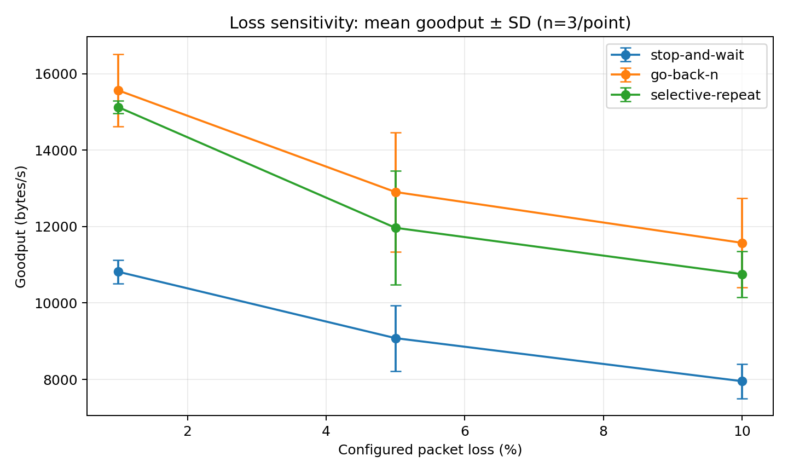
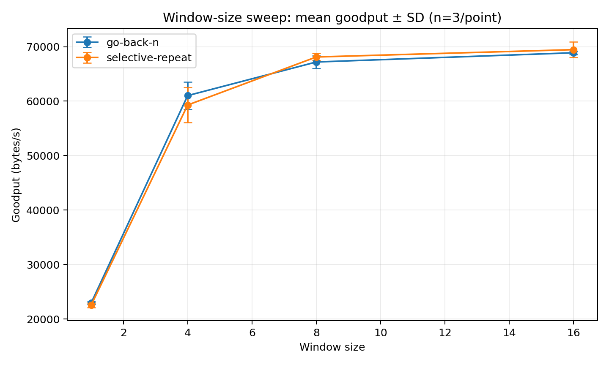
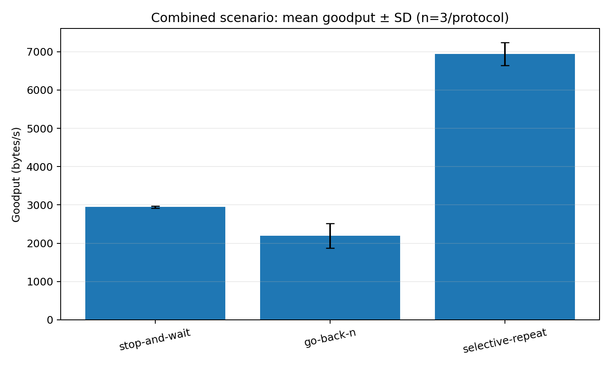
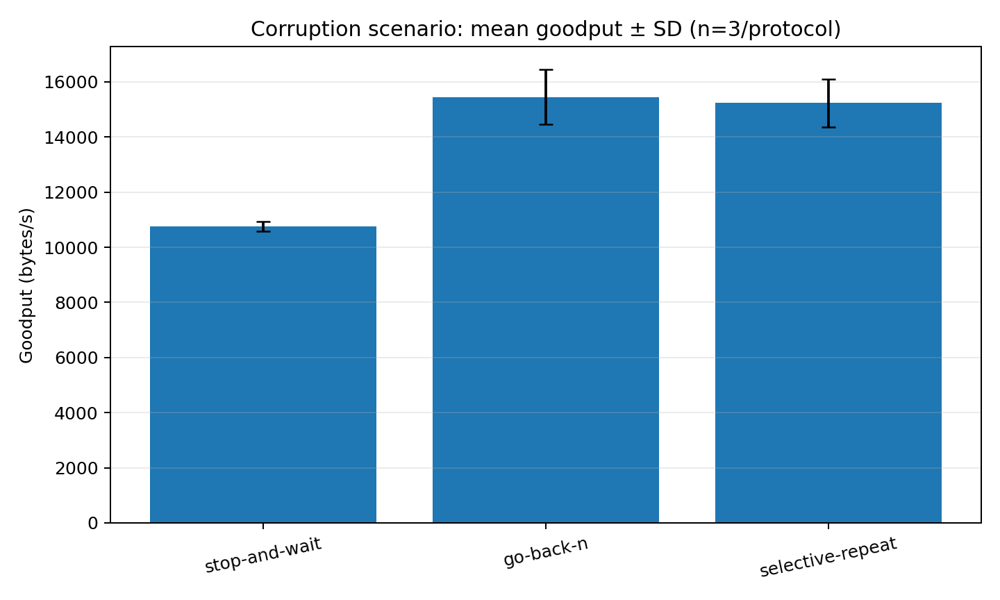
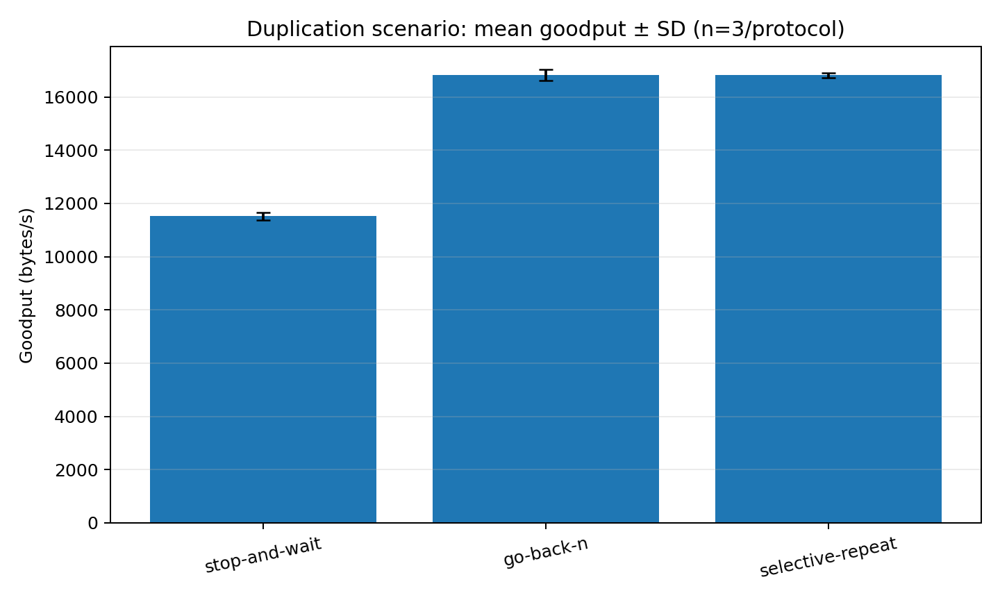
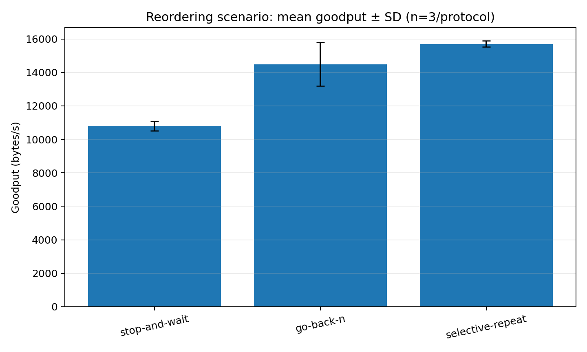

# Reliable UDP Transfer Campaign — Final Results

## Executive summary

The supplied `transfer_campaign_final.csv` contains **96 runs across seven experiment groups**. All 96 rows report `status=completed`, `exit_code=0`, and `integrity_ok=true`. There are no duplicate `run_id` values or missing CSV cells. The experiment-group counts match the planned 96-run allocation.

These results support comparisons for this implementation under the configured channel emulator and workload. They do not establish universal performance rankings for ARQ protocols.

## Dataset validation

| Check | Result |
|---|---:|
| Rows | 96 / 96 expected |
| Experiment groups | 7 |
| Duplicate run IDs | 0 |
| Missing cells | 0 |
| Completed runs | 96 |
| Integrity verified | 96 |
| Exit code 0 | 96 |
| Seeds | 101, 202, 303 (32 rows each) |

| Experiment | Runs |
|---|---:|
| Baseline | 9 |
| Loss sensitivity | 27 |
| Window-size sweep | 24 |
| Reordering | 9 |
| Duplication | 9 |
| Corruption | 9 |
| Combined impairment | 9 |

The CSV's `stdout` and `stderr` fields are retained as run-level evidence. The raw input should remain unchanged; derived outputs are stored separately.

## Main observations

Goodput is reported in bytes per second. The values below are **medians across three seeds**, except the loss experiment, where each point has three seeds for each protocol. See the generated summary CSVs for means and standard deviations.

### Baseline

| Protocol | Median goodput (bytes/s) |
|---|---:|
| Stop-and-Wait | 11,495.5 |
| Go-Back-N | 16,882.0 |
| Selective Repeat | 16,860.3 |

In this no-impairment configuration, Go-Back-N and Selective Repeat have very similar median goodput and both exceed Stop-and-Wait. This is a result for the tested file size and emulator settings, not a general performance guarantee.


[Open baseline goodput plot](../../results/analysis/plots/baseline_goodput.png)

### Packet-loss sensitivity

| Configured loss | Stop-and-Wait | Go-Back-N | Selective Repeat |
|---:|---:|---:|---:|
| 1% | 10,948 | 15,992 | 15,132 |
| 5% | 9,464 | 13,791 | 12,748 |
| 10% | 8,021 | 10,989 | 10,935 |

Entries are median goodput in bytes/s (n=3 per protocol/loss point). Median goodput falls as configured loss rises for all three protocols. At 10% loss, Go-Back-N and Selective Repeat have similar median goodput in this sample.



[Open loss sensitivity plot](../../results/analysis/plots/loss_sensitivity.png)

### Window-size sweep

| Window size | Go-Back-N | Selective Repeat |
|---:|---:|---:|
| 1 | 22,957 | 22,363 |
| 4 | 61,406 | 58,711 |
| 8 | 67,825 | 68,427 |
| 16 | 68,750 | 68,768 |

Entries are median goodput in bytes/s (n=3 per protocol/window). The tested larger windows substantially improve median goodput compared with window size 1, with smaller gains from 8 to 16. These runs use a 262,144-byte payload, unlike the 65,536-byte payload used by the other groups, so do not directly compare their absolute goodput with the other experiment groups.



[Open window-size sweep plot](../../results/analysis/plots/window_sweep.png)

### Combined impairment

Median goodput was 2,961 bytes/s for Stop-and-Wait, 2,197 bytes/s for Go-Back-N, and 7,088 bytes/s for Selective Repeat. The median retransmission and timeout counts were 14/14, 267/68, and 14/14 respectively. The high Go-Back-N recovery counts and lower goodput are consistent with the cost of retransmitting later packets after a loss within a window; this is an interpretation of the observed data, not proof of a single cause.



[Open combined impairment plot](../../results/analysis/plots/combined_goodput.png)

### Corruption

The corruption experiment evaluates protocol goodput under the configured packet-corruption conditions. The plotted values show the mean and standard deviation across three runs per protocol.



[Open corruption plot](../../results/analysis/plots/corruption_goodput.png)

### Duplication

The duplication experiment evaluates protocol goodput under the configured packet-duplication conditions. The plotted values show the mean and standard deviation across three runs per protocol.



[Open duplication plot](../../results/analysis/plots/duplication_goodput.png)

### Reordering

The reordering experiment evaluates protocol goodput under the configured packet-reordering conditions. The plotted values show the mean and standard deviation across three runs per protocol.



[Open reordering plot](../../results/analysis/plots/reordering_goodput.png)

### Other impairment groups

The dataset includes isolated duplication, corruption, and reordering groups. See `summary_by_experiment_protocol.csv`, `recovery_metrics.csv`, and the corresponding plots for their observed measurements. Avoid strong conclusions from these groups: each protocol/scenario combination has only three seeds.

## Method and reporting notes

- Each planned configuration was run with seeds 101, 202, and 303.
- Baseline, loss, reordering, duplication, corruption, and combined groups use a 65,536-byte payload. The window sweep uses 262,144 bytes.
- Configured RTO is 200 ms. Run timeout is documented in the experiment plan as 180 seconds.
- All runs passed the recorded process-status and integrity checks, so no rows were excluded from the descriptive summaries.
- The tables use medians to reduce sensitivity to individual runs; generated CSVs also include means and standard deviations.
- The error bars in the plots show mean ± one standard deviation; with n=3, they are descriptive, not confidence intervals.
- Record the repository commit, machine/OS, compiler and build flags alongside any external publication. Those details are not present in this CSV and have not been inferred.

## Reproducibility

Run the analysis script with Python 3, pandas, and matplotlib:

```bash
python analyze_results.py transfer_campaign_final.csv --out results/analysis